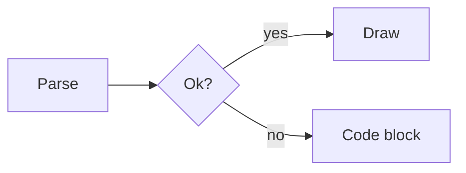
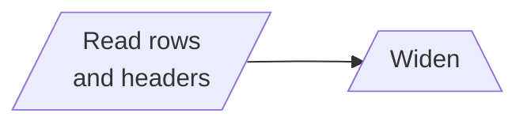
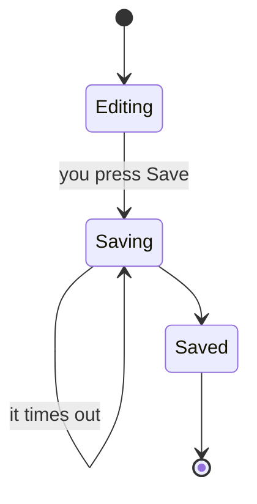

Caudra renders model replies as markdown: headings, emphasis, lists, tables,
code blocks with syntax highlighting, maths, and mermaid flowcharts.

## Shell code

A shell code block colours the body of a heredoc in the language of the
program that reads it, up to the delimiter line. The lines after
`python3 - <<'PY'` read as Python. Python, JavaScript, Ruby, Perl, PHP, Lua,
SQL clients, and shells are recognised, with versioned names such as
`python3.12` and paths such as `/usr/bin/node`. A here-string (`<<<`) and a
heredoc fed to any other program, such as `cat`, keep the shell colours.

Tool cards, permission prompts, `/permissions`, and the workbench editor
colour shell commands the same way. A tool card colours the script it shows
when open, the command on its header row, each shell row of a batch, and the
`Command` row of a background job. Colours never change the text.

## Maths

Models write maths as LaTeX. Caudra recognises four delimiters:

| Delimiter | Kind |
| --- | --- |
| `$x^2$` | inline |
| `\(x^2\)` | inline |
| `$$ ... $$` | display |
| `\[ ... \]` | display |

Terminals cannot typeset maths, so Caudra approximates it with Unicode on a
single line.

| LaTeX | Renders as |
| --- | --- |
| `\frac{a}{b}` | `a/b` |
| `\sqrt{x+1}` | `√(x+1)` |
| `\sum_{i=1}^{n} i^2` | `∑ᵢ₌₁ⁿ i²` |
| `\int_0^\infty e^{-x^2} dx` | `∫₀^∞ e^(-x²) dx` |
| `\hat{x}`, `\vec{v}`, `\overline{AB}` | `x̂`, `v⃗`, `A̅B̅` |
| `\binom{n}{k}` | `C(n, k)` |
| `\begin{pmatrix} a & b \\ c & d \end{pmatrix}` | `( a b ; c d )` |
| `a \equiv b \pmod{n}` | `a ≡ b (mod n)` |

Greek letters, blackboard bold, script letters, operators, arrows, accents,
and super- and subscripts map to their Unicode equivalents. Font commands
such as `\mathbf` and `\boldsymbol` pass their content through, since a
terminal cannot restyle text inside an equation.

Where no Unicode equivalent exists, Caudra falls back to readable ASCII rather
than dropping the term. A subscript of `x \to \infty` has no subscript glyphs,
so it renders as `lim_(x → ∞)`. A single symbol needs no grouping, so
`x^\infty` gives `x^∞`, while `x^{AB}` keeps its parentheses as `x^(AB)`.
Unknown commands render as their bare name, which is what makes `\sin`,
`\log`, and `\det` come out right without listing every function.

Parentheses appear only where flattening to one line would otherwise change
the reading. A fraction gets them because `\frac{a+b}{c}` collapses to a
linear `/`, so it renders as `(a+b)/c`. An integral does not, because `dx`
already ends the integrand: `\int_0^1 x^2 dx + 5` renders as `∫₀¹ x² dx + 5`.

Set `ui.math = "raw"` to see the LaTeX source instead of the approximation.
This helps when your font lacks the mathematical block.

```toml
[ui]
math = "raw"
```

### When a dollar sign is money

`It costs $5 and $10 total` stays plain text. Caudra treats `$...$` as maths
only when the content does not start with a digit, or when it contains a
LaTeX signal such as `\`, `^`, `_`, or `{`. So `$2^n$` is maths and `$5 and $`
is not.

A delimiter with no closing partner stays plain text. Half-streamed equations
therefore read as source until the closing delimiter arrives, rather than
reflowing the text around them.

Maths inside a code block is code, and a code fence inside display maths is
maths. Whichever opens first wins.

## Diagrams

A ```` ```mermaid ```` block holding a flowchart or a state diagram is laid out and drawn with
box-drawing characters. Nothing is downloaded and no browser is involved, so
diagrams appear at the same speed as the rest of the reply.

````

````

```
                     yes ┌──────┐
                    ┌───▶│ Draw │
┌───────┐  ╭───────╮│ no └──────┘
│ Parse ├─▶‹  Ok?  ›┴┐
└───────┘  ╰───────╯ │
                     │   ┌────────────┐
                     └──▶│ Code block │
                         └────────────┘
```

Flowcharts start with `flowchart` or `graph`. Both keywords accept `TD`,
`TB`, `BT`, `LR`, and `RL`.

| Syntax | Support |
| --- | --- |
| `A --> B`, `A --- B`, `A -.-> B`, `A ==> B` | arrows, open links, dotted, thick |
| `A -->\|text\| B`, `A -- text --> B` | edge labels |
| `A --> B --> C`, `A & B --> C & D` | chains and fan-out |
| `A --> A` | self-loops, drawn as a hook beside the node |
| `[]`, `()`, `([])`, `[[]]`, `[()]`, `(())`, `{}`, `{{}}`, `>]` | node shapes |
| `[//]`, `[\\\\]`, `[/\\]`, `[\\/]` | parallelograms and trapezoids |
| `subgraph Name ... end` | one level, drawn as a dashed frame |
| `<br/>` in a label | line break |
| `%%`, `style`, `classDef`, `class`, `click`, `linkStyle`, front matter | accepted and skipped |

A terminal cell cannot carry a distinct outline per shape, so upright shapes
collapse onto square corners, round corners, and a doubled edge for
subroutines. Decisions keep round corners and take `‹ ›` caps on their middle
row, because a diagonal glyph meets the corner of its cell while `─` runs
through the middle, so a drawn diamond never joins up.

Leaning shapes are drawn in full, with a side that steps one column per row:

````markdown

````

```
   ┌─────────────┐
  /  Read rows  /     ┌───────┐
 / and headers /╶───▶/  Widen  \
└─────────────┘     └───────────┘
```

A slant widens its node by one column per row of text, and the two rules end
up offset from each other by the same amount. Edges stop hard against a slant
rather than landing on it, since there is no junction glyph that joins a
diagonal to a line.

State diagrams start with `stateDiagram` or `stateDiagram-v2` and reuse the
flowchart layout, so they run top to bottom unless a top-level `direction`
says otherwise.

````markdown

````

```
          ╭─────╮
          │  ●  │
          ╰──┬──╯
             │
             ▼
        ╭─────────╮
        │ Editing │
        ╰────┬────╯
     ┌───────┘you press Save
     ▼
╭────────╮
│ Saving ├─┐ it times out
│        │◀┘
╰────┬───╯
     └───────┐
             ▼
         ╭───────╮
         │ Saved │
         ╰───┬───╯
             │
             ▼
          ╭─────╮
          │  ◉  │
          ╰─────╯
```

| Syntax | Support |
| --- | --- |
| `[*] --> A`, `A --> [*]` | start `●` and end `◉` markers, one pair per region |
| `A --> B`, `A --> B : text` | transitions and their labels, with `<br/>` drawn as a space |
| `state "Long name" as id`, `id : text` | state labels, where `<br/>` breaks the line |
| `state id { ... }` | composite states, drawn as a dashed frame |
| `--` inside a composite | concurrent regions, one frame each |
| `state id <<choice>>` | choices, drawn as a decision |
| `direction LR` | the chart's direction at the top level, skipped inside a composite |
| `%%`, `classDef`, `class`, `:::name`, `style`, `note`, front matter | accepted and skipped |

Frames do not nest. A composite inside another composite gets a frame of its
own beside its parent's. A transition that starts or ends at a composite
meets a box named after it, drawn inside the composite's frame. Colours from
`classDef` are dropped, so a legend that explains them shows only its labels.

Anything outside these tables leaves the block as a highlighted code fence.
Sequence diagrams, class diagrams, pie charts, nested subgraphs, and the forks
and joins of state diagrams all fall back this way. A half-drawn diagram would be worse than the
source, so Caudra draws only what it fully understands, and it waits for the
closing fence before laying anything out.

Wide diagrams clip at the edges and mark each cut with `‹` or `›`. Hover one
and scroll sideways, or press `Shift+Left` and `Shift+Right`, to pan it in
place. Panning never changes a diagram's height, so the transcript around it
stays put. The keys move whichever diagram shows the most rows on screen,
preferring the later message when two are equal.

Set `ui.mermaid = "off"` to leave every mermaid block as code.

```toml
[ui]
mermaid = "off"
```

## Links

Explicit Markdown links, HTTP(S) autolinks, and bare HTTP(S) URLs are underlined. Hover a link to show its target. Supporting terminals receive OSC 8 hyperlink metadata, and a click can use an available local desktop or WSL opener.

Interactive targets must use HTTP or HTTPS, include a host, and contain no control characters. Other schemes remain visible text without an interactive target.

## Images

The transcript draws pictures as thumbnails up to 16 rows tall. They appear on `view_image` and `image_generate` tool cards, for Markdown images such as ``, and under a prompt you sent with attached images.

Markdown images load only from local files. A relative path resolves against the session's working directory, and a `file:` URL works too. Caudra never fetches an image over the network, and a session on a remote workspace never reads this machine's disk. When a picture cannot be drawn, its alt text stays as a label.

Click a picture to open the image viewer. Each image attached to a draft shows as an `[Image #1]` chip under the composer, and a click on a chip opens the same viewer.

Use `+` and `-` to zoom, `0` to fit the picture, `1` for actual-size inspection, and the arrow keys to pan. The mouse wheel zooms around the pointer, and dragging pans the picture. Press `s` to switch between smooth resampling and nearest-neighbour sampling for pixel detail. These controls work on pasted images too.

`Esc` or a click outside the picture closes the viewer, including a click in the blank margins inside the modal. Hint buttons still perform their actions, and dragging beyond the picture does not close it. For an image with a file, `o` opens it in your system viewer, `w` opens it in the workbench, and `y` copies its path.

Actual-size inspection uses one source pixel per terminal pixel with pixel graphics. With character graphics, it uses one source pixel per sample along the coarser axis and preserves the picture's proportions. When the terminal does not report its pixel size, the viewer uses an estimate. Block graphics still approximate each cell with two colours, even when zoomed in. The workbench uses the same inspection controls for local image files.

With `"auto"`, Caudra probes for Kitty image graphics. When the terminal answers, it draws image pixels sized to the display area. Otherwise Caudra uses coloured block characters, two by two samples to a cell. The terminal and any multiplexer between it and Caudra must support the image protocol and its Unicode placeholders. Inside tmux, Caudra requires `allow-passthrough` and a compatible client terminal. Inside Herdr, automatic mode keeps block rendering because accepting a graphics query does not yet guarantee visible placeholders. Forcing `"kitty"` can produce a blank image there.

Set `"sextants"` for sharper blocks, two by three pixels to a cell. They need a font that has the Unicode 13 sextant characters, or a terminal that draws them itself, such as Ghostty, kitty, WezTerm, or foot. Without one, pictures show as boxes.

```toml
[ui]
inline_images = "sextants" # "auto" (default), "kitty", "blocks", "sextants", or "off"
```

`inline_images = false` is the same as `"off"`, which keeps every picture as its label.

## Copying

Releasing a mouse drag copies the selected Markdown source, not the glyphs on
screen. `Ctrl+X y` copies the latest assistant reply as Markdown. A copied table
has its pipes, a heading has its `#`, and an equation has its `$` delimiters
and LaTeX. Pasting into a file or a chat gives back what the model wrote.

Rendering is lossy in both directions, so some constructs copy whole. Select
part of an equation, a table row, or a list marker and you get the entire
construct, because half of `\frac{a}{b}` is not valid LaTeX. Touching any cell
of a drawn diagram copies the whole fenced block, fence lines included, since
no part of the artwork maps back to a slice of the source. Emphasis, headings,
and inline code copy at character precision.

A picture copies as Markdown that names it again, such as ``.

The role prefix is part of the interface and never reaches the clipboard.

In WSL, every copy also asks the terminal to take the text with OSC 52, so it
reaches the Windows clipboard even when WSLg does not pass it on. Orca needs
Allow TUI Clipboard Writes (OSC 52) for this. Current Orca releases turn it on
by default, and older ones leave it off.
